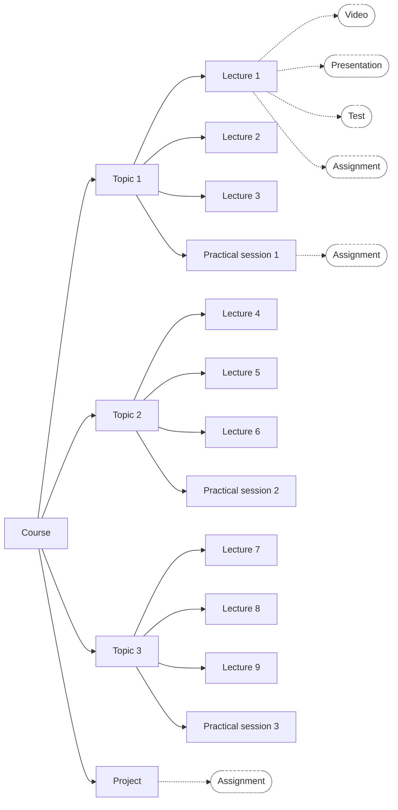

# Course structure

## A course is a tree {#tree}

On the screen of the author app, a course is a tree. At the top is the course card, below it the sections, below the sections — the subsections. What to call the levels — blocks, modules, sessions, lessons — is up to you: the Course Supporter platform only distinguishes nesting. On the screen, a section is sometimes called something else — for example, in the window title "Node description — … (Опис вузла — …)"; it is the same section.

A section is a place in the tree. Materials — videos, presentations, texts, assignments, tests — are kept in sections; they are not sections themselves.

<!-- frame 4: the course page — the whole tree: the course card, sections, subsections -->

For example, the course "Agentic development in Python" («Агентна розробка на Python») is built like this: the course card, below it "Block 0: Introduction" («Блок 0: Вступ»), then six blocks — each with several lessons — and "Final project" («Фінальний проєкт»); 23 sections in all.

A left click on a card opens the section panel: its materials, uploads and description. All actions with a section are in the menu that opens with a right click on the card.

## Example: a course of three topics {#example}

Let us show with an example how to turn a course plan into a tree. The course consists of three topics; each topic has three lectures. Each lecture has a video, a presentation, a test and an assignment; after each topic there is a practical session; after the whole course — a project.

In the diagram, rectangles are sections, and ovals with a dashed border are materials kept in a section:

To keep it readable, materials are shown only in lecture 1, practical session 1 and the project; in the other sections they are the same.

The course is taken in this order: lecture 1 (video, presentation, test, assignment), lecture 2, lecture 3, practical session 1, lecture 4, …, practical session 3, project. This order is set by two rules: sections of the same level go in the order you created them, and the materials of a section go in the order they were uploaded, and they come before its subsections.

This determines where to put things. A practical session or a project is a section that is itself a learning block of one lesson and carries its own assignment. You can create it either as a subsection of the topic after the lectures, or as a section on the same level as the topics: the order of taking the course will be the same, because it is set by the place in the tree. It is different with an assignment kept as a material in a section that also has subsections. If the practical session were kept as a material in the "Topic 1" section, it would come before the lectures of that topic, and a project put as a material into the course would come before all the topics. So make whatever has to come after the lectures a separate section, and create it after the lectures. Create all sections in the order they are to be taken (see [Order of sections](#order)).

The platform does not lock the next materials: any of them can be opened, so the order is your hint. This is how the platform works as of October 2026.

## The section menu {#menu}

<!-- frame 5: the section menu opened with a right click — all seven items -->

- "Add subsection (Додати підрозділ)" — opens the "New subsection (Новий підрозділ)" window: type the title and press "Create (Створити)".
- "Upload material (Завантажити матеріал)" — adds materials to the section; about them — [Materials](materials.md).
- "New test (Новий тест)" — opens the test editor; about it — [Tests](tests.md).
- "Process materials (Обробити матеріали)" with the caption "Layer 1 + 2 (Шар 1 + 2)" — repeats processing only for the section's materials in the "Error (Помилка)" state; it is not needed before the Methodist (see [The three processing steps](how-it-works.md#layers)).
- "Generate description (Згенерувати опис)" with the caption "Layer 3 (Шар 3)" — runs the Methodist for this section and everything below it; from the course card — for the whole course ([Section descriptions: the Methodist](methodist.md)).
- "Rename (Перейменувати)" — changes the title; the section description does not change by itself because of this, and the app warns you about it.
- "Delete (Видалити)" — removes the section with everything nested in it, after the question "Delete "…" and everything nested in it?" («Видалити «…» та все вкладене?»). On the course card, this item deletes the whole course.

<!-- frame 6: the "New subsection (Новий підрозділ)" window -->

<!-- frame 7: the section panel after clicking a card — "View/edit description (Переглянути/редагувати опис)", the "Drag files here (Перетягніть файли сюди)" zone, the link field, "New test (Новий тест)", the list of materials -->

## Order of sections {#order}

Important: a new section always becomes the last among its neighbours, and you cannot change the order or move a section in the app — as of October 2026, there is no button for it at all. So create sections straight away in the order the student should see them.

If you made a mistake, delete the section while it is empty and create it again in the right sequence. If the section is already filled, the platform administrator can fix the order: write to them and say what should go where.

You can move a card with the mouse, but that only shifts it on the screen: the order will not change, and after the page is refreshed the card returns to its place.

Next — [Materials](materials.md).
