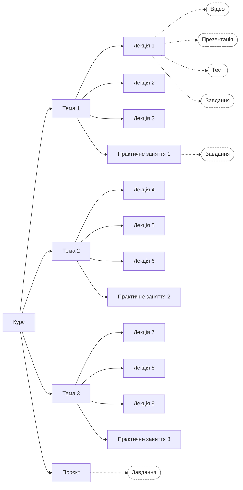

# Структура курсу

## Курс — це дерево {#tree}

Курс на екрані програми автора — це дерево. Угорі картка курсу, під нею розділи, під розділами — підрозділи. Як назвати рівні — блоки, модулі, заняття, уроки — вирішуєте ви: платформа Course Supporter розрізняє лише вкладеність. На екрані розділ інколи названо інакше — наприклад, у назві вікна «Опис вузла — …»; це той самий розділ.

Розділ — це місце в дереві. Матеріали — відео, презентації, тексти, завдання, тести — лежать у розділах; самі вони розділами не є.

<!-- кадр 4: сторінка курсу — дерево цілком: картка курсу, розділи, підрозділи -->

Для прикладу, курс «Агентна розробка на Python» побудовано так: картка курсу, під нею «Блок 0: Вступ», далі шість блоків — у кожному по кілька занять — і «Фінальний проєкт»; разом 23 розділи.

Клацання лівою кнопкою миші на картці відкриває панель розділу: його матеріали, завантаження й опис. Усі дії з розділом — у меню, яке відкривається правою кнопкою миші на картці.

## Приклад: курс із трьох тем {#example}

Покажемо на прикладі, як задум курсу перетворити на дерево. Курс складається з трьох тем; у кожній темі — по три лекції. До кожної лекції є відео, презентація, тест і завдання; після кожної теми — практичне заняття; після всього курсу — проєкт.

На схемі прямокутники — розділи, а овали з пунктирною рамкою — матеріали, які лежать у розділі:

Для наочності матеріали показано лише в лекції 1, практичному занятті 1 і проєкті; в інших розділах вони такі самі.

Курс проходять у такому порядку: лекція 1 (відео, презентація, тест, завдання), лекція 2, лекція 3, практичне заняття 1, лекція 4, …, практичне заняття 3, проєкт. Цей порядок задають вам два правила: розділи одного рівня йдуть у тому порядку, у якому ви їх створили, а матеріали розділу — у порядку завантаження, і стоять вони над його підрозділами.

З цього випливає вибір місця. Практичне заняття чи проєкт — розділ, який сам є навчальним блоком із одного заняття й несе власне завдання. Його можна створити і підрозділом теми після лекцій, і розділом того самого рівня, що й теми: порядок проходження буде той самий, бо його визначає місце в дереві. Інакше буде з завданням, що лежить матеріалом у розділі, який має й підрозділи. Якби практичне заняття лежало матеріалом у розділі «Тема 1», воно стояло б над лекціями цієї теми, а проєкт, покладений матеріалом у курс, — над усіма темами. Тому те, що має бути після лекцій, робіть окремим розділом і створюйте його після лекцій. Усі розділи створюйте в тому порядку, у якому їх треба проходити (див. [Порядок розділів](#order)).

Платформа не закриває наступні матеріали: можна відкрити будь-який, тож порядок — це ваша підказка. Так працює платформа станом на жовтень 2026.

## Меню розділу {#menu}

<!-- кадр 5: меню розділу, відкрите правою кнопкою миші — усі сім пунктів -->

- «Додати підрозділ» — відкриває вікно «Новий підрозділ»: впишіть назву й натисніть «Створити».
- «Завантажити матеріал» — додає в розділ матеріали; про них — [Матеріали](materials.md).
- «Новий тест» — відкриває редактор тесту; про нього — [Тести](tests.md).
- «Обробити матеріали» з підписом «Шар 1 + 2» — повторює обробку лише тих матеріалів розділу, що мають стан «Помилка»; перед Методистом він не потрібен (див. [Три кроки обробки курсу](how-it-works.md#layers)).
- «Згенерувати опис» з підписом «Шар 3» — запускає Методиста для цього розділу й усього під ним; з картки курсу — для всього курсу (сторінка «Описи розділів: Методист» готується).
- «Перейменувати» — змінює назву; опис розділу від цього сам не зміниться, про що програма й попередить.
- «Видалити» — прибирає розділ з усім вкладеним, після запитання «Видалити «…» та все вкладене?». На картці курсу цей пункт видаляє весь курс.

<!-- кадр 6: вікно «Новий підрозділ» -->

<!-- кадр 7: панель розділу після клацання на картці — «Переглянути/редагувати опис», зона «Перетягніть файли сюди», поле посилання, «Новий тест», перелік матеріалів -->

## Порядок розділів {#order}

Важливо: новий розділ завжди стає останнім серед сусідів, а змінити порядок чи перенести розділ у програмі не можна — станом на жовтень 2026 для цього немає жодної кнопки. Тому створюйте розділи одразу в тому порядку, у якому їх має бачити студент.

Якщо помилилися — видаліть розділ, поки він порожній, і створіть заново в потрібній послідовності. Якщо розділ уже заповнено, порядок може виправити адміністратор платформи: напишіть йому й назвіть, що куди переставити.

Картку можна посунути мишею, але це лише зсув на екрані: порядок не зміниться, і після оновлення сторінки картка повернеться на місце.

Далі — [Матеріали](materials.md).
